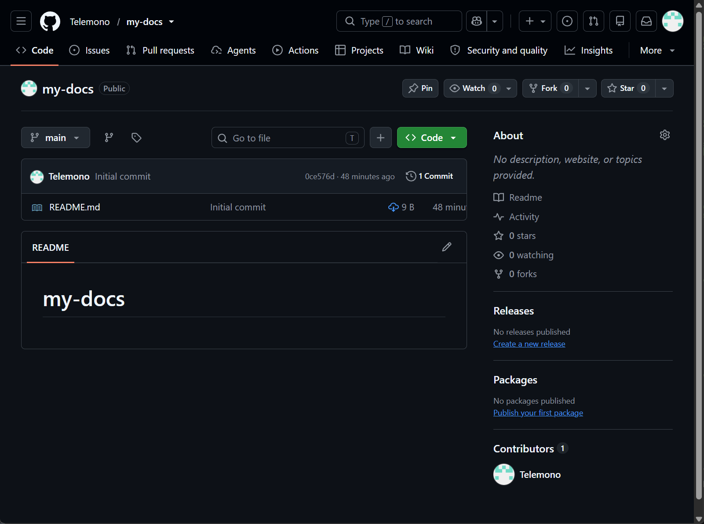
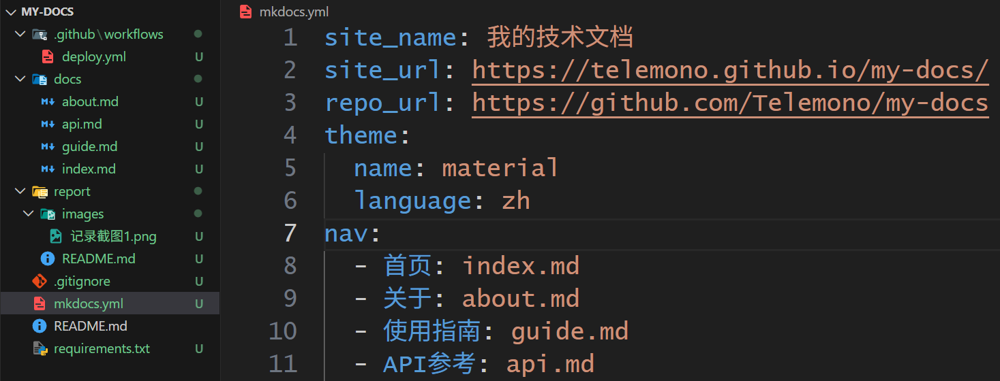
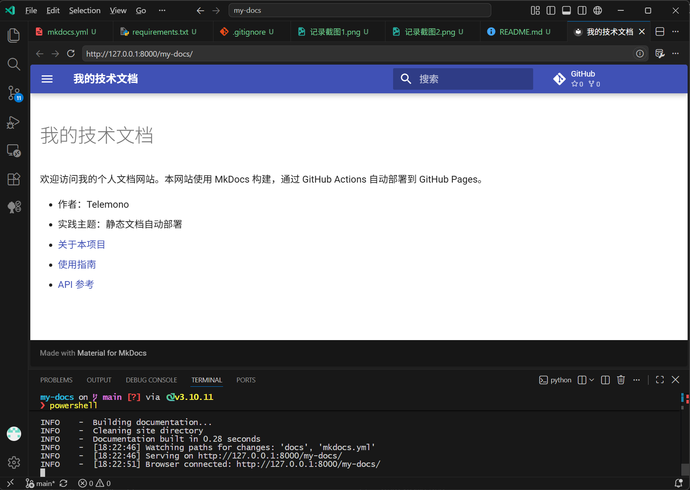
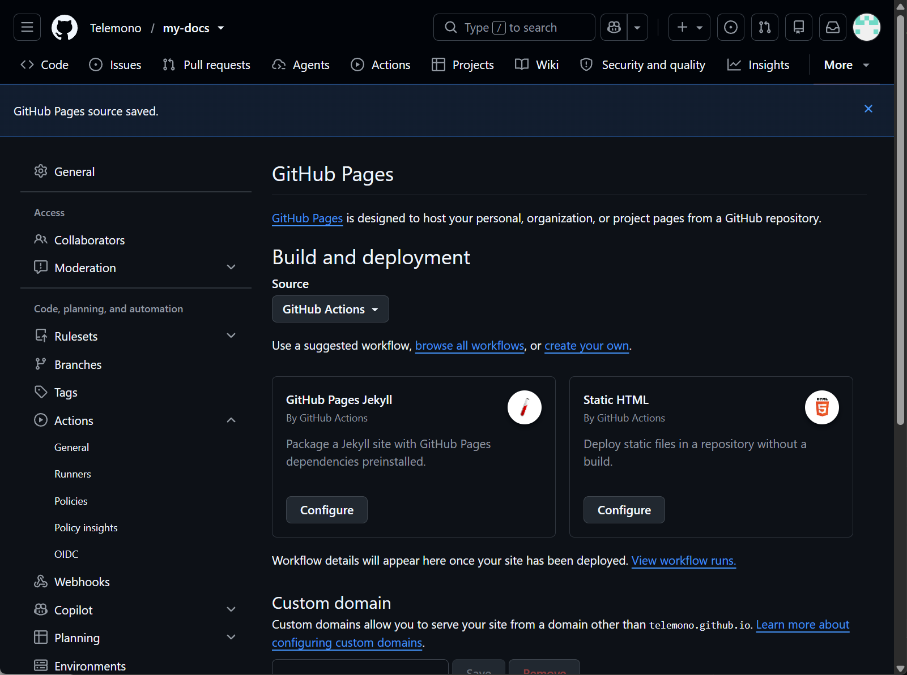
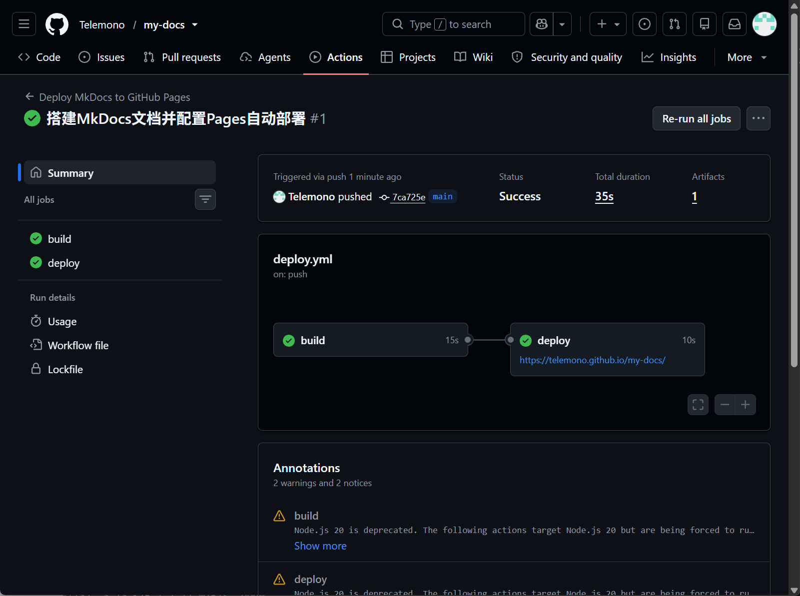
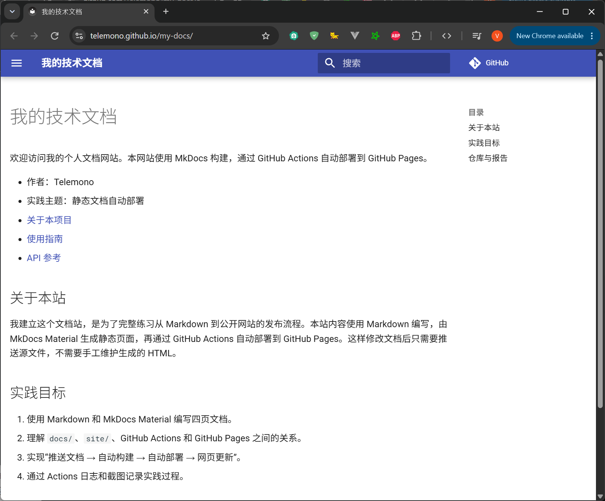
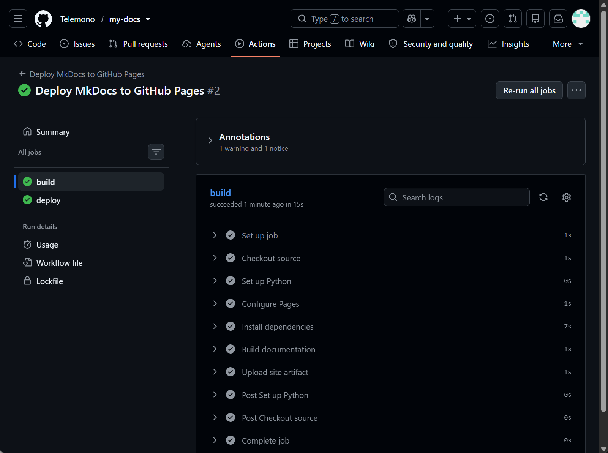
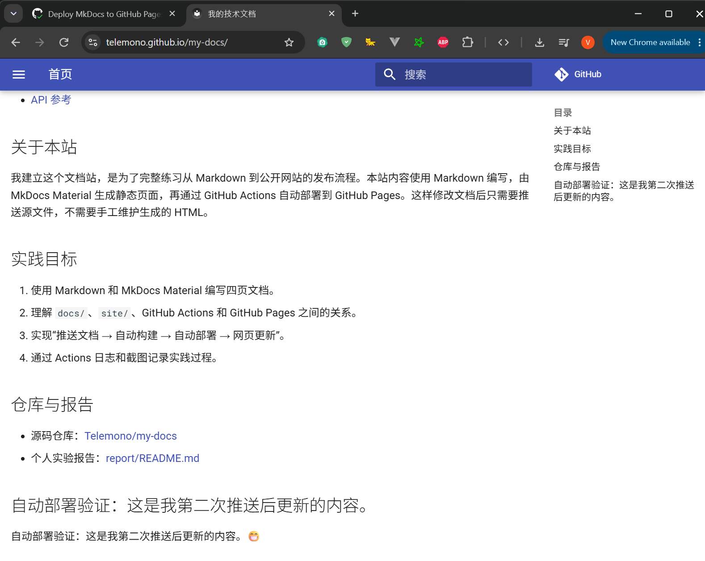

# 实践项目2：个人实验报告

## 1. 基本信息

- GitHub 登录名：Telemono
- 个人仓库地址：https://github.com/Telemono/my-docs
- 最终网站地址：https://telemono.github.io/my-docs/

## 2. 实践过程与关键截图

### 2.1 仓库创建

使用 Telemono 账号创建一个公开仓库 `my-docs`，默认分支为 `main`，然后克隆到本地进行编辑。截图①中可以看清仓库所有者为 Telemono、仓库名为 my-docs，仓库名旁边有 `Public` 标识，当前分支为 `main`。



### 2.2 项目结构与 MkDocs 配置

项目分为源文件、配置、自动化流程和报告四部分：

- `docs/`：网站的源内容，保存 `index.md`、`about.md`、`guide.md`、`api.md` 四个 Markdown 文件。
- `mkdocs.yml`：站点配置。`site_name` 是网站标题，`site_url` 写成带仓库路径的 `https://telemono.github.io/my-docs/`，`repo_url` 指向源码仓库，`theme` 使用 Material 并设置中文，`nav` 决定左侧导航的顺序和标题。
- `nav` 中的 `index.md`、`about.md` 等路径是**相对于 `docs/` 目录**解析的，因此不能写成 `docs/index.md`；否则 MkDocs 会找不到文件。
- `site/`：`mkdocs build` 生成的静态网站产物，包含 HTML、CSS、JavaScript 和搜索索引。该目录由构建自动生成，每次构建都会重新生成，已被 `.gitignore` 忽略，不需要手工修改或提交到 `main`。
- `.github/workflows/deploy.yml`：GitHub Actions 工作流，负责在云端构建并把 `site/` 发布到 Pages。
- `report/`：本报告及截图。



### 2.3 本地构建或预览

本地创建 `.venv` 虚拟环境并安装 `requirements.txt` 后，执行 `python -m mkdocs build --strict` 和 `python -m mkdocs serve`。终端显示 `Building documentation...`、`Documentation built in 0.28 seconds`，预览地址为 `http://127.0.0.1:8000/my-docs/`。

检查了以下内容：

- 顶部导航的“首页、关于、使用指南、API参考”四个入口都能正常跳转。
- 首页显示了作者、实践主题以及指向关于、使用指南、API参考的三个页面间链接。
- 关于页的“技术组成”表格能正常渲染，表头和四行内容对齐。
- 使用指南的编号列表和常用命令显示正常。
- API 参考页的代码缩进和引号没有被 Markdown 破坏。
- Material 主题的中文界面、搜索框和 GitHub 仓库链接显示正常。



### 2.4 Pages 设置

在个人仓库中进入 `Settings` → `Pages` → `Build and deployment`，把 `Source` 选择为 **GitHub Actions**，页面提示 `GitHub Pages source saved.`。



### 2.5 Actions 首次构建和部署

首次推送（提交 `7ca725e`）后，`Deploy MkDocs to GitHub Pages` 工作流自动运行，本次运行编号为 #1，总耗时 35 秒，其中 `build` 用时 15 秒、`deploy` 用时 10 秒，两个任务均为绿色。

- `build` 任务依次执行源码检出、配置 Python 3.12、`configure-pages`、安装依赖、`mkdocs build --strict`，最后把 `site/` 上传为 Pages artifact。
- `deploy` 任务通过 `needs: build` 等待构建成功，然后使用 `pages: write`、`id-token: write` 权限和 `github-pages` 环境发布网站，并输出 `page_url`。
- `workflow_dispatch` 允许在 Actions 页面手动重跑，便于首次失败后排错。

- 首次 Actions 运行链接：https://github.com/Telemono/my-docs/actions/runs/41817336351
- 首次提交链接：https://github.com/Telemono/my-docs/commit/7ca725e64664dd8bb994d8d8cf34245deddbb799



### 2.6 网站访问与四页导航检查

首次部署成功后，我访问 `https://telemono.github.io/my-docs/`，逐一打开首页、关于、使用指南、API参考。四个页面均能正常打开，顶部导航可以跳转，关于页表格、API 页代码块和页面间链接显示正常，静态资源加载无异常。截图保留了浏览器地址栏。

- 网站实际地址：https://telemono.github.io/my-docs/
- 四页检查结果：首页、关于、使用指南、API参考均可访问，导航和内容显示正常。



### 2.7 第二次推送与自动更新验证

在 `docs/index.md` 中增加一句本人编写的验证文字：

```markdown
## 自动部署验证：这是我第二次推送后更新的内容。

自动部署验证：这是我第二次推送后更新的内容。😁
```

提交并推送后**不点击手动部署**，这次 `push` 自动触发了新的工作流运行 #2。运行成功后刷新公开网站，页面出现了新增文字“自动部署验证：这是我第二次推送后更新的内容。”，说明从提交到部署的自动更新流程有效。

- 对应提交链接：https://github.com/Telemono/my-docs/commit/1286ef16a7bc8ab123f7f58f5a1c0eda8f7701d4
- 对应 Actions 运行链接：https://github.com/Telemono/my-docs/actions/runs/41817897943





## 3. 问题与解决

本地构建和两次自动部署都没有出现阻塞性失败，`mkdocs build --strict` 构建成功，`build` 与 `deploy` 均为绿色。核对过程中记录了以下现象：

1. 截图③中本地虚拟环境实际为 Python 3.10.11，而工作流固定使用 Python 3.12。本地只用于预览页面效果，最终线上构建以 Actions 中的 3.12 为准；如果本地与线上渲染有差异，应优先查看 Actions 日志。
2. 预览地址是 `http://127.0.0.1:8000/my-docs/` 而不是根路径，这是因为 `site_url` 配置了仓库子路径，属于正常现象。
3. Actions 运行页面提示 Node.js 20 已弃用（Annotations 中显示 `Node.js 20 is deprecated...`）。该警告来自工作流所用 Action 的运行时，不是 MkDocs 构建错误；本次 build 和 deploy 都成功，未影响网站发布。后续可以关注 actions/checkout、actions/setup-python 等 Action 的版本说明，按官方建议升级。

两次部署的核对结果：

- `Settings` → `Pages` 的 Source 为 GitHub Actions。
- 两次 Actions 运行中 `build` 和 `deploy` 均为绿色。
- `Upload site artifact` 步骤成功上传 `site/`。
- 网站地址带有 `/my-docs/` 仓库路径，首页、关于、使用指南、API参考四页均可打开。
- 第二次推送后，首页出现新增的验证文字，说明自动更新生效。

## 4. 原理理解

1. **`docs/` 和 `site/` 各保存什么？为什么不用手工修改 `site/`？**

   `docs/` 保存手写的 Markdown 源文件，是网站内容的唯一来源；`site/` 保存 `mkdocs build` 生成的 HTML、CSS、JavaScript 和搜索索引，是构建产物。`site/` 每次构建都会被重新生成，并且已被 `.gitignore` 忽略；手工修改会在下一次构建时被覆盖，也会造成源文件与线上页面不一致。因此只修改 `docs/`，由构建流程生成 `site/`。

2. **本次工作流在什么情况下自动运行？**

   当代码推送到 `main` 分支，并且改动命中 `docs/**`、`mkdocs.yml`、`requirements.txt` 或 `.github/workflows/deploy.yml` 时自动运行。也可以在 Actions 页面通过 `workflow_dispatch` 手动运行。只修改 `report/README.md` 或根目录 `README.md` 不会自动运行。

3. **`build` 与 `deploy` 两个任务有什么区别？**

   `build` 负责准备构建环境：检出源码、安装 Python 3.12 和依赖、执行 `mkdocs build --strict`，并把生成的 `site/` 上传为 Pages artifact。`deploy` 不重新构建，它通过 `needs: build` 等待构建成功，然后获得 Pages 写入和 OIDC 令牌权限，在 `github-pages` 环境中把 artifact 发布成网站，并输出网站地址。

4. **只修改 `report/README.md` 会触发部署吗？为什么？**

   不会。工作流的 `paths` 过滤只包含 `docs/**`、`mkdocs.yml`、`requirements.txt` 和 `deploy.yml`，不包含 `report/`。修改报告只会保存到仓库，不会改变网站内容，因此不触发部署是预期行为。

5. **本次方案为何无需创建 `gh-pages` 分支？**

   本方案使用 GitHub 官方 Pages Actions：`configure-pages` 配置 Pages，`upload-pages-artifact` 上传构建产物，`deploy-pages` 直接把 artifact 发布到 Pages。Pages 的 Source 设置为 GitHub Actions，由部署环境托管产物，因此不需要把 `site/` 推到 `gh-pages` 分支，也不需要额外申请访问令牌或开启创建/批准 PR 的权限。
